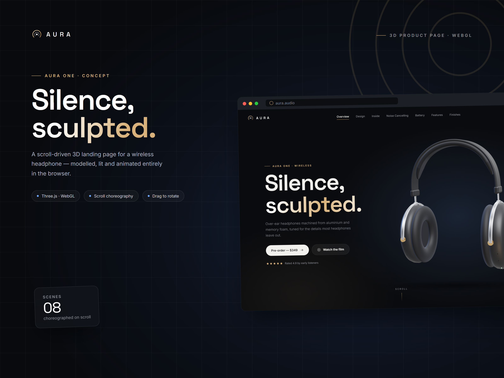
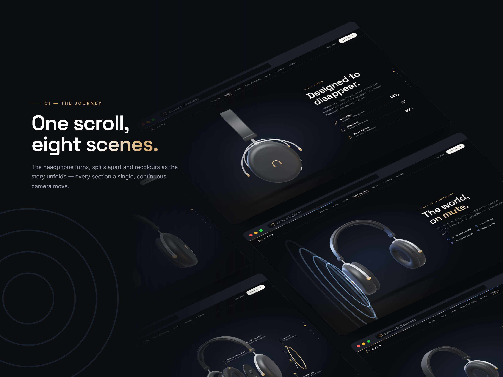
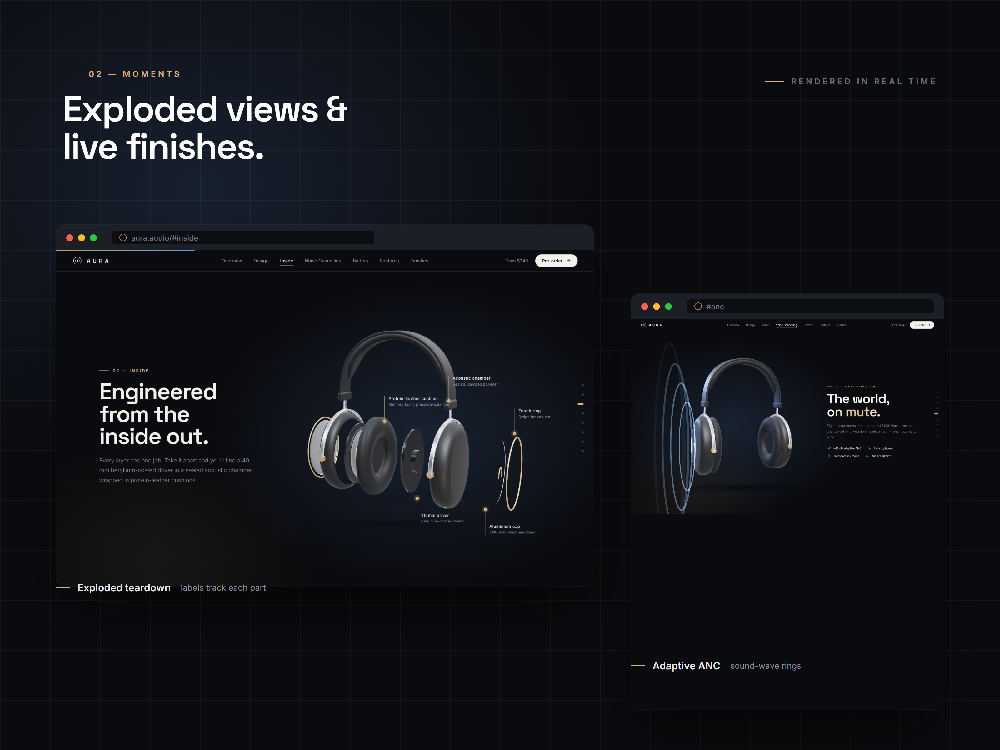
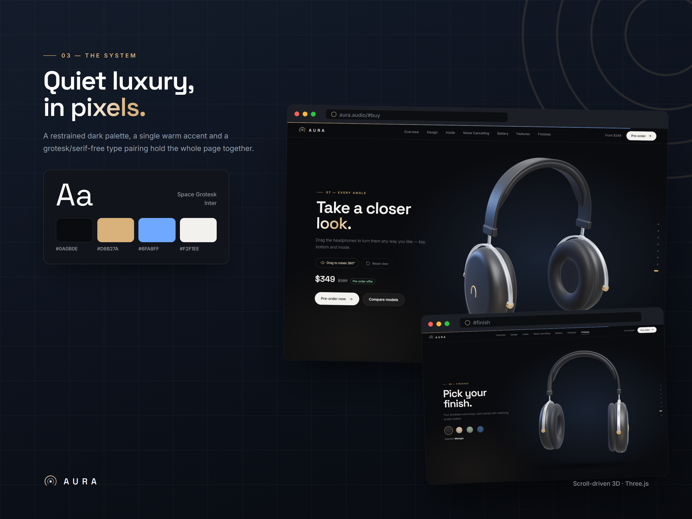

# AURA One — 3D Product Page

A scroll-driven 3D landing page for **AURA One**, a concept pair of wireless noise-cancelling headphones. The headphones are modelled, lit and animated entirely in the browser with [Three.js](https://threejs.org/), with no 3D model files.



## Features

- **Scroll choreography:** the headphones turn, split apart and move across eight sections as you scroll.
- **Exploded view:** the ear cup separates into cushion, driver, chamber, cap and touch ring, with labels that follow each part.
- **Noise-cancelling rings:** animated sound waves pulse out from the ear cup.
- **Live finishes:** four colourways (Midnight, Sandstone, Sage, Ocean) recolour the model smoothly.
- **Drag to rotate:** in the last section you can turn the headphones in any direction with the mouse.
- **Responsive:** on phones the model centres and the text moves below it.
- **Built in code:** the model is generated from Three.js geometry and the icons are inline SVG.

## Screenshots

| | |
|---|---|
|  |  |
|  | |

## Run locally

The page loads its JavaScript as an ES module, so browsers won't run it from a double-clicked `file://` path. Serve the folder over HTTP instead:

```bash
npx serve .
```

Then open the URL it prints (usually `http://localhost:3000`).

## Editing

The page loads the minified files. Edit the readable sources, then rebuild:

```bash
npm install
npm run build
```

This writes `css/style.min.css` and `js/main.min.js`.

## Project structure

```
Aura/
├── index.html          Page markup
├── favicon.svg
├── css/
│   ├── style.css       Stylesheet source
│   └── style.min.css   Minified (loaded by the page)
├── js/
│   ├── main.js         Three.js scene and scroll logic (source)
│   └── main.min.js     Minified (loaded by the page)
├── scripts/
│   └── build.js        Minifies CSS and JS
├── screenshots/        Presentation images
└── package.json
```

## Deploy

It's a static site, so any static host works. For **GitHub Pages**: push the repo, go to **Settings → Pages**, choose your branch and the root folder, and save.

## Credits

- [Three.js](https://threejs.org/) 0.160, loaded from the jsDelivr CDN
- Fonts: [Space Grotesk](https://fonts.google.com/specimen/Space+Grotesk) and [Inter](https://fonts.google.com/specimen/Inter) from Google Fonts

AURA is a fictional brand. The product, specs and price are placeholder content for this concept.
